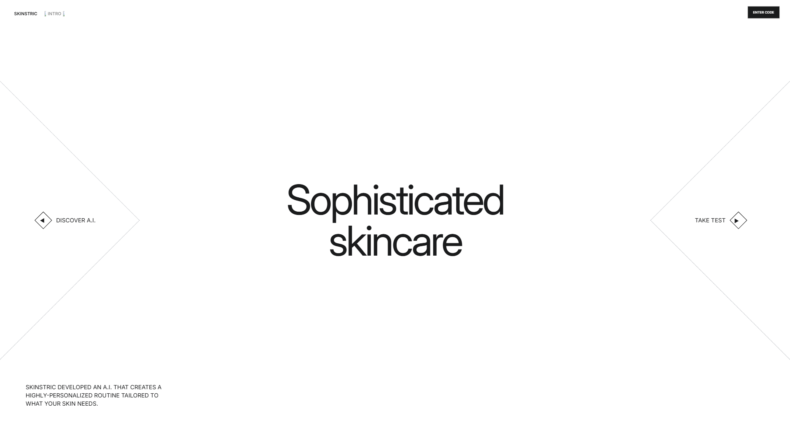

# Skinstric AI

A front-end build of the Skinstric AI skincare analysis experience, made during the Frontend Simplified internship. Visitors introduce themselves, take or upload a photo, and get an AI estimate of their demographics that they can review and adjust.

**Live:** https://skinstric-rosy.vercel.app

## Features

- Two-step intake that checks the name and city before sending them to the API
- Photo capture with the device camera, or a photo upload when no camera is available
- Results page that sorts the AI estimate into race, age and sex, with a percentage for each option
- Animated diamond layout and loading states that match the original design
- Responsive layout for phone and desktop

## Built with

Next.js 16 (App Router) · TypeScript · Tailwind CSS v4 · Vercel

## Getting started

Requires Node 20.9 or newer (run `node -v` to check).

    git clone https://github.com/robertandersonux/skinstric.git
    cd skinstric
    npm install
    npm run dev

Then open http://localhost:3000.

## Structure

- `app/` holds one folder per page: testing (intake), camera and capture, select, result and summary
- `lib/` holds the two API calls, input validation and the demographics helpers
- `components/` holds the shared header and the diamond layout
